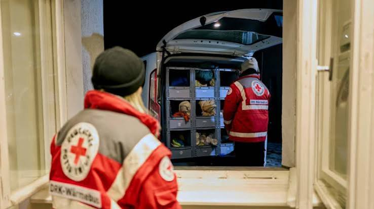

In Berlin sind seit Sonntag mehrere Busse unterwegs, um bedürftigen Menschen in der kalten Jahreszeit zu helfen. Sie fahren durch die Stadt und bieten ihnen etwa warme Getränke, Schlafsäcke und Fahrten zu Notunterkünften an. Bis zum 31. März fahren drei Busse der Berliner Kältehilfe der Stadtmission täglich, wie eine Sprecherin sagte. Neben den Mobilen der Kältehilfe fährt täglich bis 31. März auch der DRK-Wärmebus, so ein Sprecher des Berliner Deutschen Roten Kreuzes. In besonders kalten Phasen könnten zudem auch weitere Busse mobilisiert werden. So war es laut DRK etwa zu Beginn des Jahres während der über längere Zeit anhaltenden eisigen Temperaturen. Die Berliner Kältehilfe teilte zudem mit, dass sie weiter aufstocke. Die Zahl der Übernachtungsplätze für Obdachlose werde von bislang 700 auf auf knapp 1.000 aufgestockt. Die bisherigen Notübernachtungsplätze waren zuletzt trotz moderater Temperaturen bereits zu rund 90 Prozent ausgelastet.

Der **DRK-Wärmebus** ist für die kommenden fünf Monate **täglich von 18 Uhr bis Mitternacht** unterwegs und unter der Telefonnummr 030- 600 300 1010 erreichbar. Die **Kältebusse der Stadtmission** sind **täglich von 20 Uhr bis 1.30 Uhr** unter 030 690 333 690 erreichbar.

## Informationen der Menschen helfen

Eine Person sollte immer erst angesprochen und gefragt werden, ob und inwiefern sie Hilfe brauche, riet die Sprecherin der Stadtmission. Manche freuten sich etwa über eine heiße Suppe oder Tee, während andere Schlafsäcke oder auch eine Fahrt zu einer Unterkunft benötigten. Außerdem würden mehr Informationen dem Callcenter helfen, die Route der Busse besser zu koordinieren. Ab dem Beginn der kalten Jahreszeit sind zwei neue Kältebusse für die Stadtmission im Einsatz. Nachdem Anfang des Jahres ein Mann Brände gelegt hatte, waren zwei der bisherigen Busse mit [Totalschäden](https://www.rbb24.de/panorama/beitrag/2025/12/berlin-kaeltebusse-stadtmission-brandstiftung-obdachlose-hilfe-spenden.html) ausgefallen. Mit Hilfe von Spenden konnte die Organisation demnach neue Fahrzeuge kaufen und umbauen. Diese haben den Angaben nach nun elektrische Hebebühnen, sodass in Zukunft auch mobilitätseingeschränkte Menschen zu Unterkünften gefahren werden können. In der vergangenen Saison hatten die Teams der Kältebusse den Angaben nach Kontakt zu rund 3.800 Menschen und brachten davon etwa 1.800 in eine warme Bleibe. "Tendenz steigend", heißt es von der Stadtmission.

## DRK verzeichnet letzten Winter ebenfalls mehr Kälteinsätze

Auch beim DRK gab es den Angaben nach in der vergangenen Saison mit knapp 1.900 Hinweisen doppelt so viele wie im Vorjahr. Das habe gezeigt, wie groß der Hilfsbedarf sei, sagte der Präsident des Berliner DRK, Mario Czaja. "Wir rechnen damit, dass unser Wärmebus in diesem Winter noch häufiger gebraucht wird". Deswegen sei die Unterstützung aus der Bevölkerung sehr wichtig. Wer Menschen sieht, die Hilfe brauchen könnten, sollte diese ansprechen und fragen, ob sie Unterstützung wünschen. "Ein Anruf bei unserem Wärmebus kann Leben retten", so Czaja. Bei medizinischen Notfällen oder akuter Lebensgefahr sollte die 112 gewählt werden.

Quelle: [rbb24](https://www.rbb24.de/panorama/beitrag/2026/11/busse-beduerftige-kaeltehilfe-obdachlose-berlin.html)
