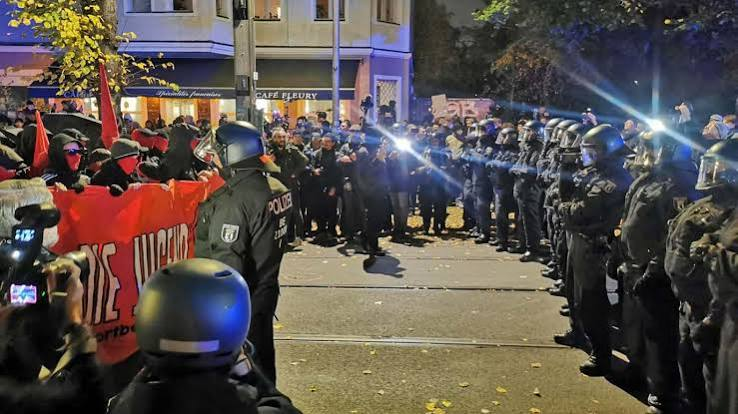

**Nach dem Ende der Gen Z-Demo am Brandenburger Tor hat sich das Protestgeschehen nach Berlin-Mitte verlagert. Dort war die Stimmung deutlich aufgeheizter. Nach Stein- und Flaschenwürfen wurde die Demo vorzeitig beendet.**

* Rund 3.500 Menschen bei Protest-Demo "GenZ hat genug!" in Berlin-Mitte
* Einige warfen mit Eiern, Flaschen und Böllern - mehrere Festnahmen
* Mehrere Polizisten leicht verletzt
* Zuvor friedliche Demo am Brandenburg Tor

Nach dem [friedlichen Ende der Protestkundgebung "Gen Z regelt" am Brandenburger Tor](https://www.rbb24.de/politik/beitrag/2026/10/berlin-gen-z-regelt-demo-jugend-protest-polizei.html) kam es in Berlin-Mitte zu einer weiteren Demonstration. Diese wurde vom Veranstalter in Absprache mit der Polizei frühzeitig gestoppt. Grund dafür seien unter anderem Würfe von Eiern, Steinen und Flaschen auf Polizisten sowie das Abbrennen von Pyrotechnik gewesen, wie Polizeisprecherin Julia Scholz am Abend gesagt hatte. In der Nacht teilte die Polizei mit, 27 Beamte seien leicht verletzt worden, insgesamt habe es 56 Festnahmen gegeben.

Der in Mitte begonnenen Protestzug sei nach den Flaschenwürfen in Absprache mit dem Veranstalter frühzeitig kurz vor der Diesterwegstraße in Prenzlauer Berg gestoppt worden, so die Polizeisprecherin. Eigentlich hätte es noch ein paar hundert Meter weiter bis zum S-Bahnhof Prenzlauer Allee gehen sollen. Die anschließenden Szenen beschrieb die Polizei als "eine Art Katz-und-Maus-Spiel". Teilweise spielte sich das Geschehen in Nebenstraßen ab. Einige Menschentrauben wären noch vor Ort geblieben, darunter auch Schaulustige. Nach rund einer Stunde, gegen 20.00 Uhr, hatte sich die Lage wieder beruhigt.

## 
Polizei: Stimmung am Abend von Anfang an angespannt

Zu Beginn der Demo mit dem Titel "GenZ hat genug!" hatten sich am frühen Abend nach Polizeiangaben rund 700 Menschen am Rosenthaler Platz nahe der bekannten Hackeschen Höfe versammelt. Von dort aus zogen die Demonstranten in Richtung Prenzlauer Berg. Dabei stießen immer mehr Menschen hinzu, die Polizei sprach schließlich von 3.500 Teilnehmerinnen und Teilnehmern.

##### 

Die Stimmung sei von vornherein "sehr angespannt" gewesen, sagte eine Polizeisprecherin. Unter dem Demonstrierenden wären viele dunkelgekleidete und vermummte Menschen gewesen. rbb-Reporter berichteten von einem schwarzen Block am Rosenthaler Platz. Sprechchöre wie "Ganz Berlin hasst die Polizei" seien zu hören gewesen. Der Veranstalter des abendlichen Protestzuges wird von der Polizei dem linken Spektrum zugeordnet, auch Teilnehmer der propalästinensischen Szene waren vor Ort. Die Polizei begleitete die Demo mit zahlreichen Beamtinnen und Beamten und war an Halloween am Tag und in der Nacht insgesamt mit rund 1.500 zusätzlichen Polizistinnen und Polizisten in der Stadt unterwegs.

## Organisatoren der Demo am Nachmittag distanzierten sich

[Zuvor hatten am Nachmittag mehrere tausend Menschen am Brandenburger Tor friedlich gegen Kürzungen im Sozial- und Bildungsbereich demonstriert. ](https://www.rbb24.de/politik/beitrag/2026/10/berlin-gen-z-regelt-demo-jugend-protest-polizei.html)Die Polizei zählte dort rund 5.000 Teilnehmer, die Organisatoren der Initiative "Gen Z regelt" sprachen von 11.000 Menschen. Die Organisatoren der Demo im Regierungsviertel hatten sich im Vorfeld von der Demo am Rosenthaler Platz distanziert und zur Gewaltfreiheit aufgerufen.

## Proteste auch in Köln, Frankfurt und Hamburg

Am Rande der bundesweiten Jugendproteste kam es am Abend und in der Nacht in mehreren deutschen Städten zu Zusammenstöße mit der Polizei. In Frankfurt am Main wurden Beamte laut Polizeiangaben am Samstag [mit Steinen beworfen, die Behörden setzten deswegen Wasserwerfer ein](https://www.hessenschau.de/panorama/nach-gen-z-demo-pluenderungen-und-polizeigrosseinsatz-in-frankfurt-v12,gen-z-ausschreitungen-frankfurt-100.html). Mindestens ein Polizist wurde demnach verletzt und musste ärztlich behandelt werden. Randalierer schlugen hier außerdem Scheiben von Geschäften auf der Einkaufsstraße "Zeil" ein, es soll auch zu Plünderungen gekommen sein. In Hamburg wurden die Einsatzkräfte nach Polizeiangaben am Steintorplatz ["mit pyrotechnischen Gegenständen" beworfen](https://www.tagesschau.de/inland/ausschreitungen-frankfurt-koeln-100.html). Die Polizei setzte ihrerseits Wasserwerfer gegen die Demonstranten ein, ebenso in Köln. In Bonn wurde laut Polizei ein Beamter bei einer Auseinandersetzung mit einer Gruppe leicht verletzt.

###### 
Quelle: [rbb24](https://www.rbb24.de/panorama/beitrag/2026/10/demo-gen-z-hat-genug-rosenthaler-platz-polizei.html)
