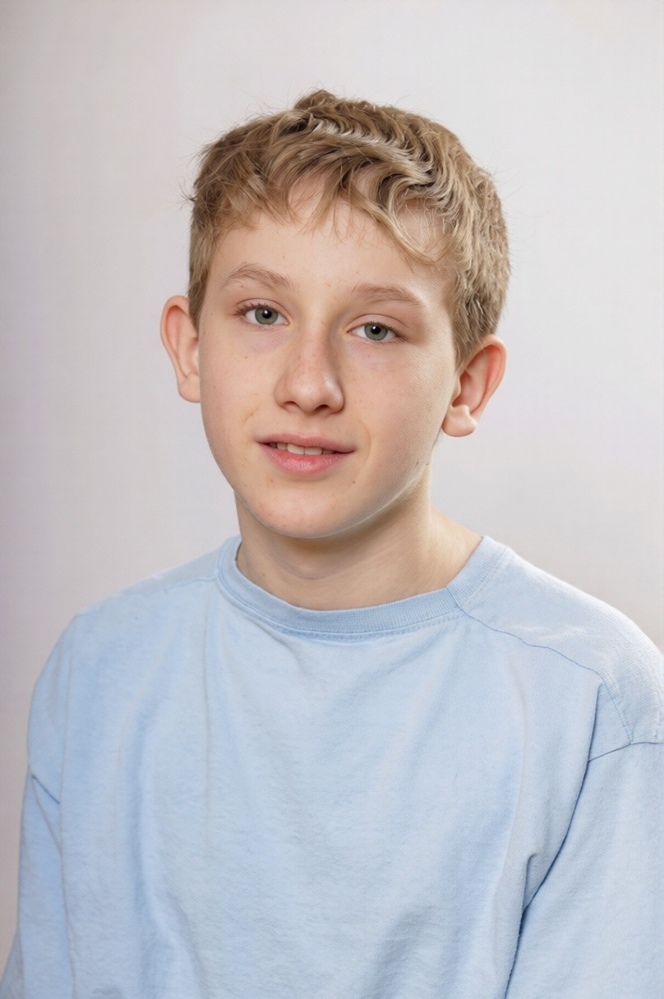

<!DOCTYPE html>
<html lang="de" class="scroll-smooth">
<head>
    <meta charset="UTF-8">
    <meta name="viewport" content="width=device-width, initial-scale=1.0">
    <meta name="theme-color" content="#1e3a8a">

    <title>{{ page.title }}</title>
    <meta name="description" content="{{ page.description }}">
    <meta name="keywords" content="{{ page.keywords }}">
    <meta name="robots" content="{{ page.robots }}">
    <link rel="icon" type="image/jpeg" href="auge-logo.jpg">
    <link rel="canonical" href="https://julian13053.github.io/index.html">

    <meta property="og:type" content="website">
    <meta property="og:title" content="{{ page.title }}">
    <meta property="og:description" content="{{ page.description }}">
    <meta property="og:image" content="https://julian13053.github.io/auge-logo.jpg">
    <meta property="og:url" content="https://julian13053.github.io/index.html">

    <link rel="stylesheet" href="/style.css">

    
    
    
</head>
<body class="text-slate-900 font-sans antialiased flex flex-col min-h-screen relative overflow-x-hidden">

    

    <!-- Navigation -->
    

    <!-- ================= HERO ================= -->
    <header class="animate-hero relative mx-3 sm:mx-4 -mt-[5.75rem] pt-36 pb-24 md:pt-40 md:pb-32 px-6 md:px-12 rounded-b-[44px] md:rounded-b-[72px] overflow-hidden text-white shadow-[0_40px_80px_-30px_rgba(30,58,138,0.6)]"
            style="background: linear-gradient(135deg, #1d4ed8 0%, #1e3a8a 48%, #312e81 100%);">

        <!-- Lebendiger Hintergrund -->
        

        

        

        

        <!-- Lichtkante oben im Glas -->
        

        

            

                

                    
                        
                        Design &amp; Development für Pflege-Agenturen
                    
                

                

                    <h1 class="text-[2.75rem] leading-[1.02] sm:text-6xl md:text-7xl font-extrabold tracking-tight relative inline-block pb-4">
                        Julian Fleger.
                        
                            <svg viewBox="0 0 500 20" fill="none" xmlns="http://www.w3.org/2000/svg" class="w-full h-full" preserveAspectRatio="none">
                                <path d="M5 15C130 5 370 4 495 15" stroke="currentColor" stroke-width="5" stroke-linecap="round" class="animate-draw"/>
                            </svg>
                        
                    </h1>
                    Punktgenau verbunden.
                

                

                    

                        Ich bin Julian. Ich teile meine kreativen Ideen, Brandings und Web-Projekte sowie neue, spannende Blogartikel.
                    

                

                

                    <a href="blog.html" class="group relative inline-flex w-full md:w-auto items-center justify-center gap-2 rounded-2xl px-8 py-4 font-extrabold text-blue-950 no-underline bg-gradient-to-br from-cyan-300 to-cyan-400 shadow-[0_12px_30px_-10px_rgba(34,211,238,0.8),inset_0_1px_0_rgba(255,255,255,0.6)] transition-all duration-500 ease-[cubic-bezier(0.34,1.4,0.64,1)] hover:-translate-y-1 hover:shadow-[0_20px_40px_-12px_rgba(34,211,238,0.9),inset_0_1px_0_rgba(255,255,255,0.7)] active:scale-[0.97] overflow-hidden">
                        
                        Direkt zum Blog
                        →
                    </a>
                

            

            <!-- Foto in Glasrahmen mit 3D-Tilt -->
            

                

                    

                    

                        

                            
                            
                            

                        

                    

                    <!-- Schwebende Glas-Chips -->
                    

                        📰
                        {{ site.posts.size }} Artikel im Blog
                    

                    

                        ⚖️
                        Rechte-Hub
                    

                

            

        

    </header>

    <!-- ================= MAIN ================= -->
    <main class="max-w-6xl mx-auto px-5 md:px-6 pt-20 md:pt-24 flex-grow w-full relative z-20">

        <!-- Neueste Artikel -->
        <section class="mb-24 md:mb-32" aria-labelledby="latest-heading">
            

                

                    Blog
                    <h2 id="latest-heading" class="mt-2 text-4xl md:text-5xl font-extrabold tracking-tight text-slate-900">📰 Neueste Artikel</h2>
                    
Frisch aus dem Gedankenkarussell gegriffen.

                

                <a href="blog.html" class="btn-glass group px-5 py-3 text-sm text-blue-700">
                    Alle Artikel ansehen →
                </a>
            

            

                
                {% assign numeric_id = post.date | date: "%Y%m%d%H%M" %}
                
                

                <article class="blog-card liquid-glass group p-7 flex flex-col justify-between" data-post-id="{{ numeric_id }}">
                    

                        

                            {{ post.date | date: "%d.%m.%Y" }}
                            📖 {{ read_time }} Min.
                        

                        <h3 class="text-xl md:text-[1.35rem] leading-snug mb-3 line-clamp-2 transition-colors duration-300 group-hover:!text-blue-700">
                            <a href="{{ post.url | relative_url }}" class="no-underline text-inherit">{{ post.title }}</a>
                        </h3>
                        
{{ post.excerpt | strip_html }}

                    

                    

                        <a href="{{ post.url | relative_url }}" class="text-blue-600 font-bold text-sm no-underline inline-flex items-center gap-1 hover:text-blue-800">
                            Artikel lesen →
                        </a>
                        

                            <button type="button" onclick="likeUmschalten('{{ numeric_id }}', this)" class="like-btn glass-pill" aria-label="Gefällt mir">
                                🤍 0 Likes
                            </button>
                            <button type="button" onclick="favoritUmschalten('{{ numeric_id }}', this)" class="fav-btn glass-pill" aria-label="Als Favorit speichern">
                                ⭐ Favorit
                            </button>
                        

                    

                </article>
                
                

                    
Bisher wurden noch keine Blog-Artikel veröffentlicht.

                

                
            

        </section>

        <!-- Rechte-Hub -->
        <section class="glass-panel relative overflow-hidden mb-24 md:mb-32 p-8 md:p-14" aria-labelledby="rights-heading">
            <!-- dezente Farbflächen im Panel -->
            

            

            

                Neu auf M-Fleger
                <h2 id="rights-heading" class="text-4xl md:text-5xl font-extrabold tracking-tight mt-5 text-slate-900">🌍 Das große Rechte-Hub</h2>
                
Rechte gehen uns alle an – egal wie alt wir sind. Entdecke unser neues Portal, das Rechte für jeden verständlich erklärt.

            

            

                <a href="kinderrechte.html" class="liquid-glass group p-7 no-underline flex flex-col justify-between">
                    

                        🎒
                        <h3 class="text-xl transition-colors group-hover:!text-blue-700">Kinderrechte</h3>
                        
Schutz, Bildung und Freizeit. Auf Augenhöhe und einfach erklärt für Kinder und Eltern.

                    

                    Mehr erfahren →
                </a>

                <a href="menschenrechte.html" class="liquid-glass group p-7 no-underline flex flex-col justify-between">
                    

                        ⚖️
                        <h3 class="text-xl transition-colors group-hover:!text-blue-700">Menschenrechte</h3>
                        
Meinungsfreiheit, Gleichberechtigung und Würde. Die Säulen unserer Gesellschaft.

                    

                    Mehr erfahren →
                </a>

                <a href="digitalrechte.html" class="liquid-glass group p-7 no-underline flex flex-col justify-between">
                    

                        📱
                        <h3 class="text-xl transition-colors group-hover:!text-blue-700">Digitalrechte</h3>
                        
Deine Rechte im Netz. Von Datenschutz bis zum Schutz vor Cybermobbing.

                    

                    Mehr erfahren →
                </a>
            

            

                <a href="unsere-rechte.html" class="btn-brand group px-7 py-3.5">
                    Zum gesamten Rechte-Hub →
                </a>
            

        </section>

        <!-- Dynamische Liquid Berechnungen -->
        
        
        
            
            
            
            
        

        <!-- Aktivitätsringe -->
        <section id="activity-section" class="glass-dark-card relative overflow-hidden rounded-[40px] mb-8 p-8 md:p-14 text-white" aria-labelledby="activity-heading">
            

            

            

                

                    

                        Statistik
                        <h2 id="activity-heading" class="mt-2 text-3xl md:text-4xl font-extrabold tracking-tight text-white">Aktivitätsringe</h2>
                    

                    

                        <!-- Ringe -->
                        

                            

                                <svg class="-rotate-90" width="200" height="200" viewBox="0 0 200 200" aria-hidden="true">
                                    <defs>
                                        <linearGradient id="gradient-woerter" x1="0%" y1="0%" x2="100%" y2="100%">
                                            <stop offset="0%" stop-color="#FF2D55" />
                                            <stop offset="100%" stop-color="#FF6B8B" />
                                        </linearGradient>
                                    </defs>
                                    <circle cx="100" cy="100" r="92" fill="none" stroke="rgba(255,45,85,0.14)" stroke-width="16" />
                                    <circle id="circle-words" class="ring-progress" cx="100" cy="100" r="92" fill="none"
                                            stroke="url(#gradient-woerter)" stroke-width="16" stroke-linecap="round"
                                            stroke-dasharray="578.05" stroke-dashoffset="578.05" />
                                </svg>
                            

                            

                                <svg class="-rotate-90" width="160" height="160" viewBox="0 0 160 160" aria-hidden="true">
                                    <defs>
                                        <linearGradient id="gradient-artikel" x1="0%" y1="0%" x2="100%" y2="100%">
                                            <stop offset="0%" stop-color="#A3F900" />
                                            <stop offset="100%" stop-color="#C5FF4D" />
                                        </linearGradient>
                                    </defs>
                                    <circle cx="80" cy="80" r="72" fill="none" stroke="rgba(163,249,0,0.14)" stroke-width="16" />
                                    <circle id="circle-posts" class="ring-progress" cx="80" cy="80" r="72" fill="none"
                                            stroke="url(#gradient-artikel)" stroke-width="16" stroke-linecap="round"
                                            stroke-dasharray="452.39" stroke-dashoffset="452.39" style="transition-delay: 0.15s;" />
                                </svg>
                            

                            

                                <svg class="-rotate-90" width="120" height="120" viewBox="0 0 120 120" aria-hidden="true">
                                    <defs>
                                        <linearGradient id="gradient-lesezeit" x1="0%" y1="0%" x2="100%" y2="100%">
                                            <stop offset="0%" stop-color="#04C7DD" />
                                            <stop offset="100%" stop-color="#4DDFED" />
                                        </linearGradient>
                                    </defs>
                                    <circle cx="60" cy="60" r="52" fill="none" stroke="rgba(4,199,221,0.14)" stroke-width="16" />
                                    <circle id="circle-time" class="ring-progress" cx="60" cy="60" r="52" fill="none"
                                            stroke="url(#gradient-lesezeit)" stroke-width="16" stroke-linecap="round"
                                            stroke-dasharray="326.73" stroke-dashoffset="326.73" style="transition-delay: 0.3s;" />
                                </svg>
                            

                        

                        <!-- Werte (zählen beim Sichtbarwerden hoch) -->
                        <dl class="flex flex-col gap-6 text-center sm:text-left">
                            

                                <dt class="text-xs font-bold tracking-[0.16em] text-slate-400">WÖRTER</dt>
                                <dd class="mt-1 text-3xl font-extrabold tabular-nums" style="color: #FF2D55; font-family: var(--font-display);">
                                    {{ total_words }}
                                    Wörter geschrieben
                                </dd>
                            

                            

                                <dt class="text-xs font-bold tracking-[0.16em] text-slate-400">ARTIKEL</dt>
                                <dd class="mt-1 text-3xl font-extrabold tabular-nums" style="color: #A3F900; font-family: var(--font-display);">
                                    {{ site.posts.size }}
                                    Artikel geschrieben
                                </dd>
                            

                            

                                <dt class="text-xs font-bold tracking-[0.16em] text-slate-400">LESEZEIT</dt>
                                <dd class="mt-1 text-3xl font-extrabold tabular-nums" style="color: #04C7DD; font-family: var(--font-display);">
                                    {{ total_read_time }}
                                    Min. Lesezeit
                                </dd>
                            

                        </dl>
                    

                

            

        </section>
    </main>

    
    

    <!-- Likes, Favoriten & Toast (gemeinsam mit Blog und Artikeln) -->
    

    
</body>
</html>
